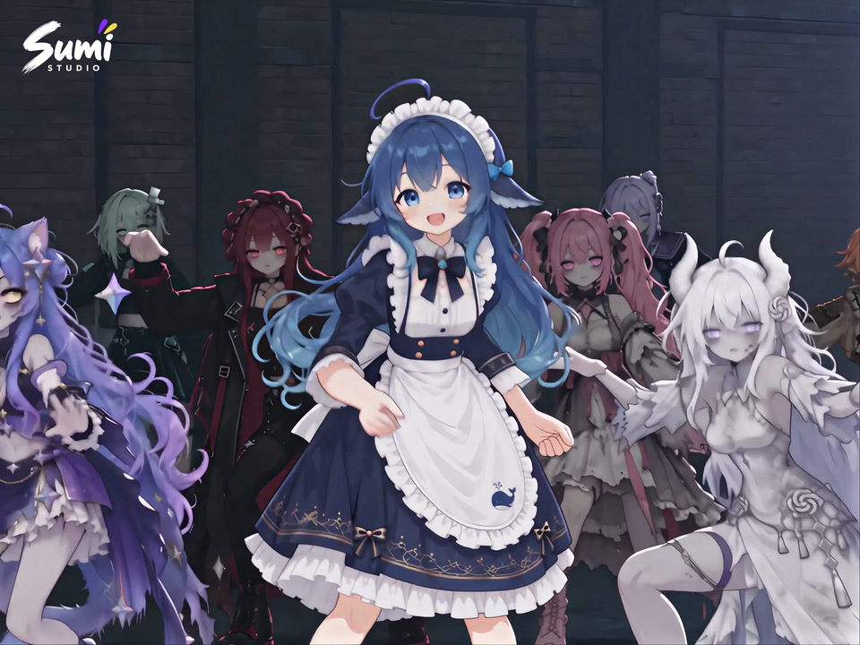

# Nicky Creative Skills

Reusable creative workflows, with the films they helped produce.

[Watch the Gallery](https://nickyli37.github.io/nicky-creative-skills/) · [Explore the skills](#skills) · [Add a skill](CONTRIBUTING.md) · [中文](README.zh-CN.md)

This is Nicky Li's growing collection of practical skills for Sumi Studio and compatible agent hosts. Each skill packages a repeatable creative process, its references and checks. The Gallery connects the instructions to real examples, with separate **category** and **style** filters.

## First film

[](https://nickyli37.github.io/nicky-creative-skills/#gallery)

**Thriller, recast with AI characters** — a complete 132.54-second dance sequence, 54 shot ranges, 4:3. The Gallery plays the full silent web preview with the Sumi Studio watermark. The original soundtrack and 4K production master are not included in this repository.

The film demonstrates the MV recast workflow; it is not a claim of pixel-exact choreography or perfect background identities. Read the [case study](docs/case-study.md).

## Skills

| Skill | Category | Example styles | Use |
|---|---|---|---|
| [sumi-mv-recast](skills/sumi-mv-recast/SKILL.md) | Music video | Anime, Cinematic | Character replacement, aligned Depth, scene references, shot repair and frame-based assembly |

Styles describe demonstrated examples; they do not restrict the skill to those styles. New skills belong in their own `skills/<name>/` folders. Add their category, styles and examples to [site/catalog.json](site/catalog.json); the Gallery discovers them automatically.

## Install and use

**Sumi Studio:** open [the public skill listing](https://sumistudio.ai/en/skills/cmvowuj2x0pe6r50k12143t1a), install it, then invoke `/sumi-mv-recast` with your source interval, approved cast and budget. The listing uses the MIT license for its instructions and code. Follow the skill's live model discovery and quote steps before generating.

**Local agent host:** copy the complete `skills/sumi-mv-recast/` folder to your host's skills directory. In Codex, this is normally `~/.codex/skills/`; start a new session if needed, then use `$sumi-mv-recast`. See [helper usage](skills/sumi-mv-recast/references/usage.md).

> Use this skill to recast my selected dance excerpt. Keep the approved lead identity, original shot lengths and framing. Align my Depth video, test difficult shots, then work within the budget I authorize.

## Repository layout

```text
skills/                 One self-contained folder per skill
site/catalog.json       Shared catalog: categories, styles, skills and examples
site/                   Static Gallery; deployed by GitHub Pages
site/media/             Small public preview media, separately licensed
docs/                   Production case study and validation notes
scripts/check_catalog.py
tests/                  Catalog and Gallery checks
```

No application build or Python package installation is required. Preview locally:

```sh
python3 -m http.server 8000 --directory site
```

Open `http://localhost:8000`. Run checks before publishing:

```sh
python3 scripts/check_catalog.py
python3 -m unittest discover -s tests -p 'test_*.py'
node --test tests/gallery.test.mjs
python3 skills/sumi-mv-recast/tests/test_media.py
```

The last command requires FFmpeg/ffprobe with H.264/AAC support. The helper tests use synthetic media only. See [validation](docs/validation.md).

## Contribute and maintain

Follow [CONTRIBUTING.md](CONTRIBUTING.md) to add a skill or film. Use one catalog entry per skill and one example entry per film; don't duplicate skills to represent different styles. Keep prompts and references inside their skill folder so Sumi imports remain self-contained.

Pushes to `main` validate the catalog and deploy `site/` to GitHub Pages. Pull requests run checks without publishing the site. This repository's Gallery needs no server, account or tracking script to watch examples.

## License

Original code, skill instructions and documentation are [MIT licensed](LICENSE). Gallery videos and posters are **excluded** from MIT; see [media terms](site/media/README.md) and [NOTICE.md](NOTICE.md). A skill license grants no rights to a source MV, music, choreography, characters or trademarks. Private production reports, full-resolution masters, credentials and temporary download links do not belong in this repository.
