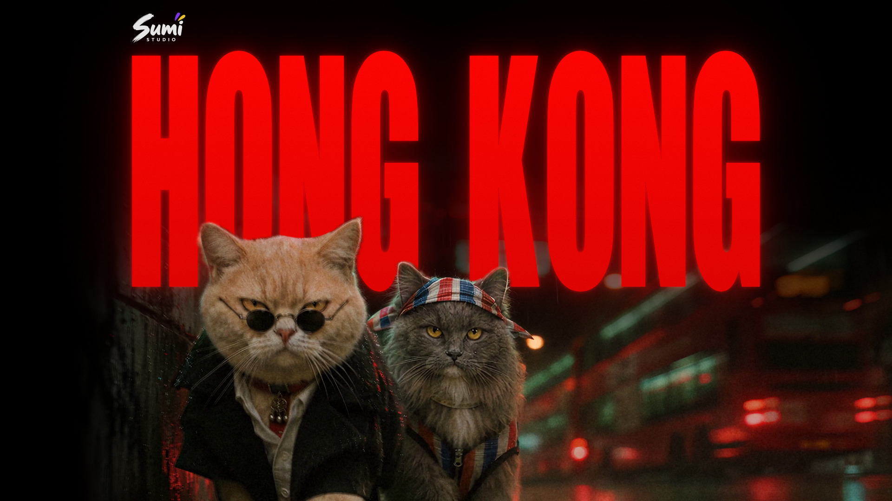

# Nicky Creative Skills

这是 Nicky Li 持续积累的创作技能库：把实际制作中有效的方法提炼成可复用 skill，并让使用者直接看到案例。

[打开 Gallery](https://nickyli37.github.io/nicky-creative-skills/) · [English](README.md) · [新增技能指南](CONTRIBUTING.md)

## 新作品：《HONG KONG》

给 The Weeknd 的新歌《HONG KONG (feat. 王菲季候風)》拍的粉丝 MV。她在九龙一个路口上了的士，之后每天晚上，两只猫都去路口的绿色铁箱上守着。Nicky Li 与 Claude 用两天做完：69 个镜头，88 条 Seedance 2.5 片段，生成和 4K 超分都通过 Sumi Studio MCP 完成，后期用 Python 和 FFmpeg 加胶片质感。成片 4 分 08 秒、24 fps，4K 母版。

[打开作品展示页](https://nickyli37.github.io/nicky-creative-skills/projects/hong-kong.html) · [查看 Skill 与示例](skills/story-mv/) · [下载 .skill](https://nickyli37.github.io/nicky-creative-skills/downloads/story-mv.skill) · [制作案例](docs/hong-kong-case-study.md)

歌曲和歌词的权利属于原作者，所以网页版没有声音，也不显示歌词。`story-mv` 包含流程、9 篇分步参考、10 个通用脚本，以及《HONG KONG》的故事、分镜、画风、提示词样例、调色参数和制作总结。完整目录可放入 `~/.claude/skills/`（Claude Code）或 `~/.codex/skills/`（Codex），依赖见 [技能 README](skills/story-mv/README.md)。公开包不含成片、片段、首尾帧、角色设定图、歌曲、歌词、字体或 Logo。视频生成和超分会消耗使用者自己的 Sumi 积分。

## 已有作品

[white-model-city-film](skills/white-model-city-film/SKILL.md)：苏州短片《人家尽枕河》，92,681 栋真实建筑、约六千年的城市故事、38 句旁白、中英双语字幕。画面由 Three.js 逐帧渲染，旁白和配乐通过 Sumi Studio MCP 生成；网页提供完整 1080p 有声版。[作品展示页](https://nickyli37.github.io/nicky-creative-skills/projects/suzhou.html) · [下载 .skill](https://nickyli37.github.io/nicky-creative-skills/downloads/white-model-city-film.skill) · [制作案例](docs/suzhou-case-study.md)

[sumi-mv-recast](skills/sumi-mv-recast/SKILL.md)：按选定段落复刻 MV，分开使用 Depth 动作参考、净场景、正式角色设定和首帧构图，再逐镜验收、局部修复、回配声音与等比例超分。

Gallery 已提供《Thriller》AI娘复刻的完整132.54秒无声网页预览，保留4:3和Sumi Studio水印。原声和4K母版未进入公开仓库。案例展示的是经过多轮制作与验收的结果，并不保证一次生成即可精准复刻。

## 分类方法

- **品类 Category**：作品用途，例如 Music video、Advertising、Short film、Product demo。
- **风格 Styles**：视觉呈现，例如 Anime、Cinematic、Photorealistic、Stop motion。
- 一个技能可以有多个风格和多个案例。Depth属于方法，不作为风格标签。

目录清单是 `site/catalog.json`，新增条目后，搜索、筛选和案例展示自动更新。目前包含剧情 MV、城市白模纪录短片与 MV 角色复刻三个技能。

## 使用 MV 角色复刻

1. 在 [Sumi Skill Market](https://sumistudio.ai/en/skills/cmvowuj2x0pe6r50k12143t1a) 安装，然后输入 `/sumi-mv-recast`。
2. 提供选中段落、正式角色、已有Depth及预算/保真优先级。已有工程和授权可继续沿用。
3. 本地宿主可复制完整 `skills/sumi-mv-recast/` 目录。Python辅助脚本需要本地FFmpeg；在Sumi中保存脚本不代表运行环境一定能执行它。

扩展步骤和本地检查见 [CONTRIBUTING.md](CONTRIBUTING.md) 与 [英文README](README.md)。

原创技能文档与代码采用MIT许可；案例视频、海报及第三方音乐/MV/人物/商标不在MIT授权范围内。见 [媒体说明](site/media/README.md)。
